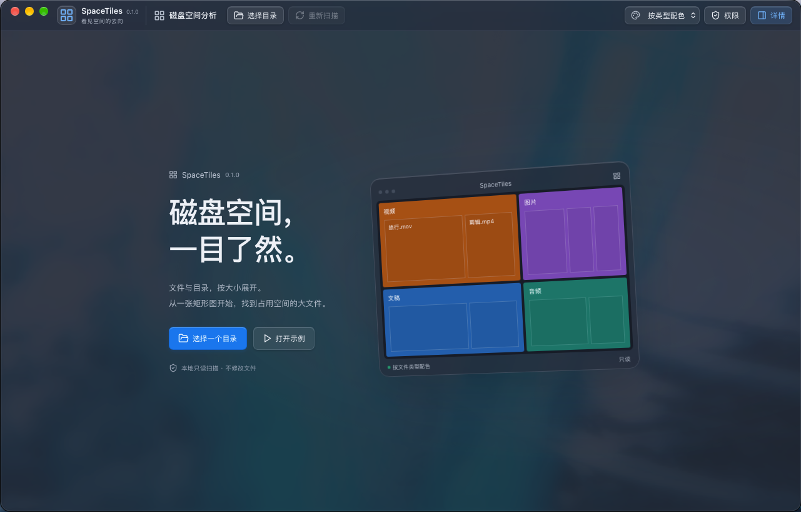
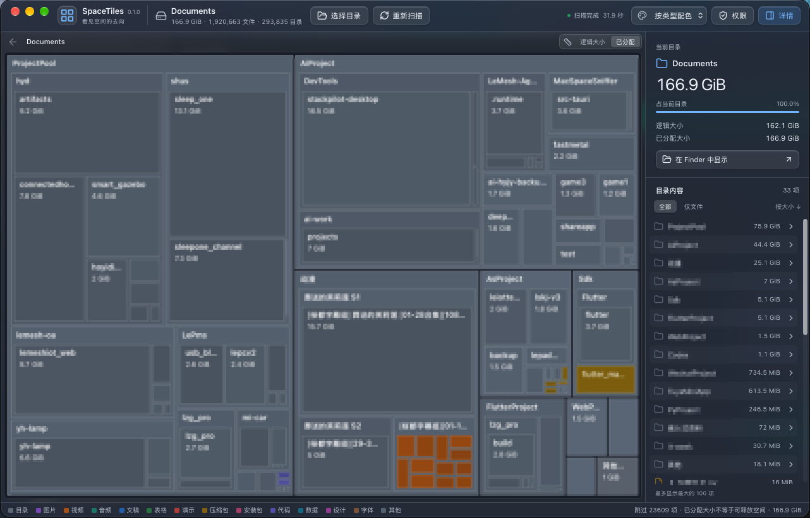

<div align="center">
  
  <h1>SpaceTiles</h1>
  <p>See where your space goes</p>
  <p>A disk space analyzer for macOS · Tauri + Rust + React · MIT</p>
  <p>English | <a href="README.zh-CN.md">简体中文</a></p>
</div>

SpaceTiles turns files and folders into a nested treemap: the more space an item uses, the larger its tile. Choose a folder, explore its contents, and locate large files in Finder.

This is an open-source hobby project, currently at **0.1 MVP**, with macOS as its first target. Windows and Linux may follow; they are not supported yet.

## Screenshots

Choose a folder to scan, or try the built-in demo first. The screenshots below show the Chinese interface; the app also includes English.



Explore the treemap alongside a size-sorted folder list. Collapse the details sidebar to give the map more room.



## Features

- **Interactive treemap:** click to inspect an item, double-click to enter a folder, and use breadcrumbs to go back.
- **File type colors:** starts with colors by type, recognizing 203 extensions across images, video, audio, documents, spreadsheets, presentations, archives, installers, code, data, design, and fonts. Folders and unknown types have their own colors. Folder-based coloring is also available.
- **Background scanning:** browse while scanning, stop a scan, or rescan. Unreadable items are reported and totals marked as incomplete.
- **Two size metrics:** switch between logical and allocated size.
- **Folder list:** sort by size, show only direct files, and reveal items in Finder.
- **Right-click actions:** open an item in Finder, copy its absolute path, or open the system Terminal at its folder. Available on treemap tiles, folder list entries, and item details. Demo data does not support file actions.
- **macOS interface:** glass materials, a compact toolbar, and system light/dark appearance. Click the brand in the top-left corner to return home without losing the current scan.
- **Automatic language:** follows the primary system language on macOS. Chinese language variants use Simplified Chinese; all other languages use English. Use **Settings → Language** to switch between **System default**, **简体中文**, and **English**. Changes apply immediately, preserve the current scan, and are remembered. With System default selected, restart the app after changing your system language. Browser previews follow the browser's primary language. Native permission dialogs follow macOS language settings.
- **Demo mode:** explore the interface without scanning real files.

Scans run locally. SpaceTiles reads metadata, not file contents, and does not upload file information. It does not delete files, clean up automatically, monitor folders in the background, or compare scan history.

## Getting started

1. Open the app and choose a folder.
2. Wait for the scan, or browse items as they are discovered.
3. Double-click a large folder tile to explore further. Click a file to see its size and details.
4. Right-click an item to choose **Open in Finder**, **Copy absolute path**, or **Open in Terminal**. You can also use **Show in Finder** in the details sidebar.

For a selected folder, Finder and Terminal open that folder. For a selected file, Finder reveals the file and Terminal opens its parent folder. Terminal opens only when you choose the action. The copied path is plain text; quote or escape it as needed when using it in a shell command.

The configured minimum is **macOS 13**. The app has been tested on Apple Silicon; older macOS versions and Intel Macs still need verification. Window materials vary by OS version.

Developer ID signing and notarization are not set up yet. Building from source is currently the main way to try the app.

## Local development

Requires **Node.js 22.12+**, stable Rust, and Xcode Command Line Tools. The first build needs an internet connection to download dependencies.

```sh
npm ci
npm run desktop
```

`desktop` starts both Vite and the desktop app, with automatic updates when source files change.

For a browser-only preview:

```sh
npm run dev
```

Open <http://127.0.0.1:1420/> and select **Try the demo**. The browser preview cannot scan local folders.

Both commands use port **1420**. Do not run them together. If the port is occupied by an earlier development server, stop it with `Ctrl+C` in its terminal before starting desktop development.

### Build the app

```sh
npm run package
```

Builds for the current machine's architecture. Output:

```text
src-tauri/target/release/bundle/macos/SpaceTiles.app
```

### Checks

```sh
npm run check
npm test
npm run format:check
cargo fmt --manifest-path src-tauri/Cargo.toml --check
cargo test --manifest-path src-tauri/Cargo.toml
cargo clippy --manifest-path src-tauri/Cargo.toml -- -D warnings
```

## Permissions and size accounting

**Ordinary folder scans do not require Full Disk Access by default.** macOS privacy protections or file permissions may block some locations. The app lists unreadable items and provides a shortcut to privacy settings. Choosing a folder does not grant access to the entire disk.

**Logical size can exceed disk capacity.** It adds up the lengths reported by files, including sparse files and APFS clones. Allocated size adds up the filesystem's reported blocks, which can include shared blocks more than once. Neither total is a direct measurement of disk usage, and **allocated size is not the space you can reclaim by deleting a file**. APFS snapshots also affect the amount actually freed.

Hard links count once, at the first path discovered. Directories are also identified by device and inode and traversed only once. On macOS, firmlinks can expose the same directory at paths such as `/Users` and `/System/Volumes/Data/Users`; scanning `/` does not count both copies. Duplicate directory entries remain visible with a skipped note, while directories unique to the Data volume are still scanned. Symbolic links are not followed, mounts on other devices are skipped, and application bundles are scanned as folders.

A scan is not an atomic filesystem snapshot. Files changing during a scan, cancelled scans, and read failures can all leave totals incomplete. To keep the interface responsive, small items may be grouped in the map, and the folder list shows up to the 100 largest items. Enter a subfolder to explore further. **Files only** lists direct files, excluding files in subfolders.

The full macOS privacy authorization lifecycle, compatibility across OS versions, and large-scale memory and performance testing are still being worked on.

## Project structure

```text
src/
  components/Treemap.tsx   Canvas rendering and interaction
  components/ItemContextMenu.tsx  Right-click file actions
  lib/layout.ts           Treemap layout and hit testing
  lib/fileTypes.ts        File classification and colors
  lib/i18n.ts             Language detection and UI translations
  App.tsx                 Scan workflow and interface
src-tauri/
  src/scanner.rs          Scanning, aggregation, and queries
  src/main.rs             Desktop commands and macOS integration
  src/menu.rs             Localized native menus
  src/platform.rs         Finder, clipboard, and Terminal actions
  locales/               Localized macOS permission descriptions
tests/                    Frontend tests
screenshots/              README screenshots
```

Bug reports and improvements are welcome. For scanning or permission issues, include your macOS version, chip architecture, reproduction steps, and error messages. Redact private paths before sharing.

## Credits and license

SpaceTiles takes inspiration from SpaceSniffer's treemap approach to exploring disk space. It is an independent project and does not use SpaceSniffer's source code or visual assets, nor is it affiliated with SpaceSniffer.

Released under the [MIT License](LICENSE).
